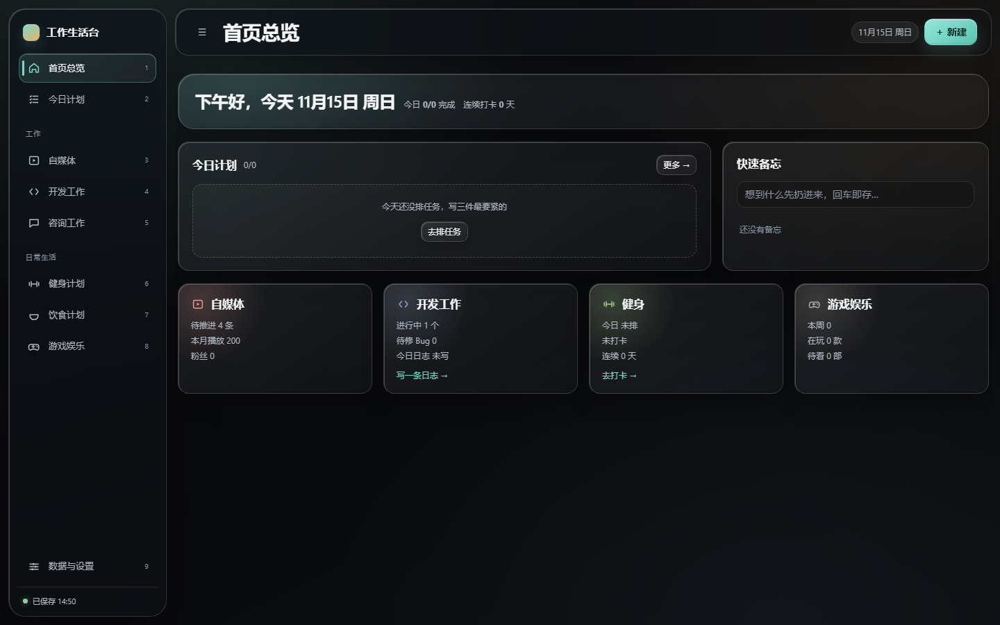
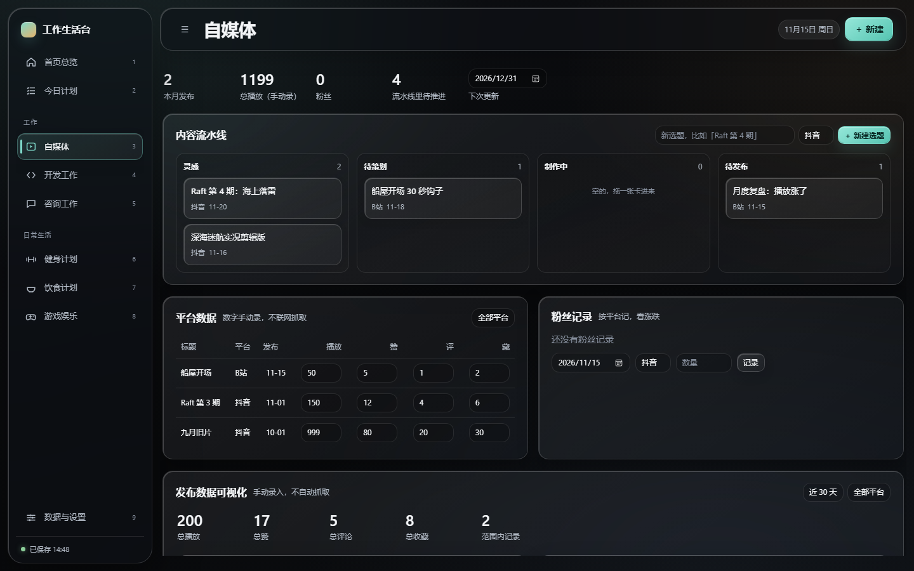
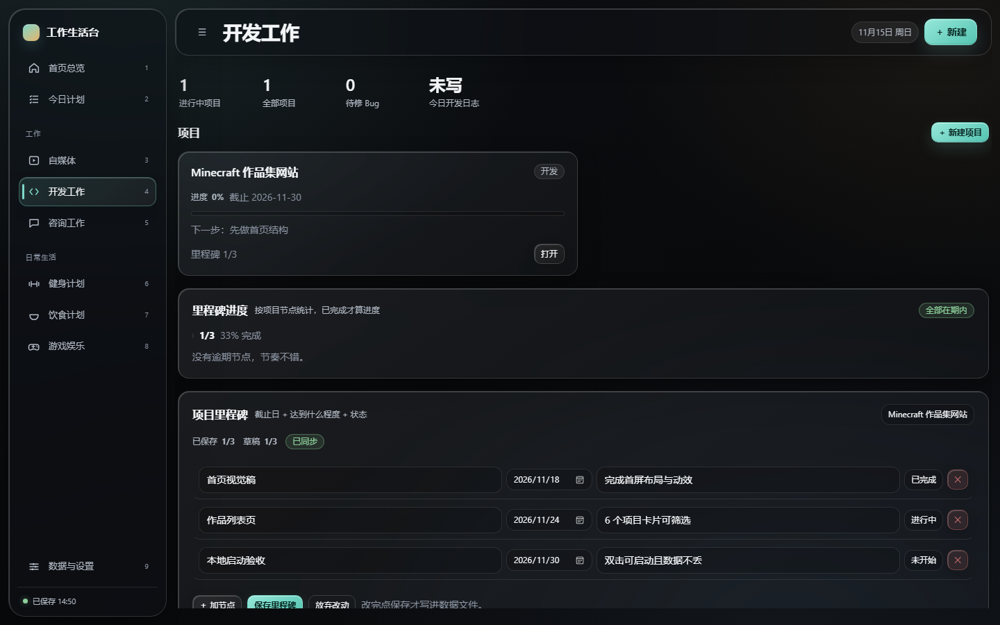
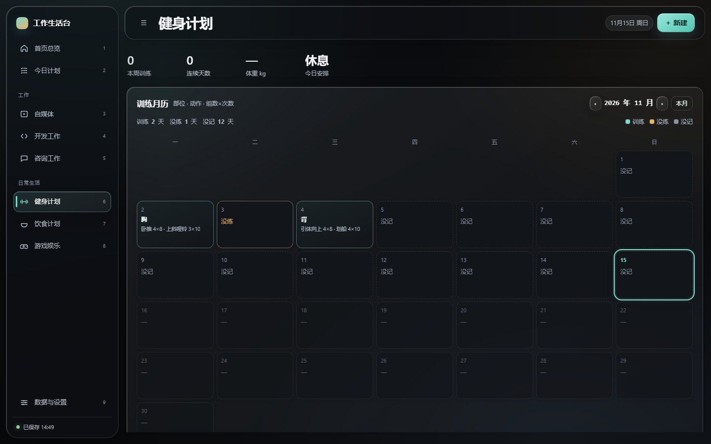
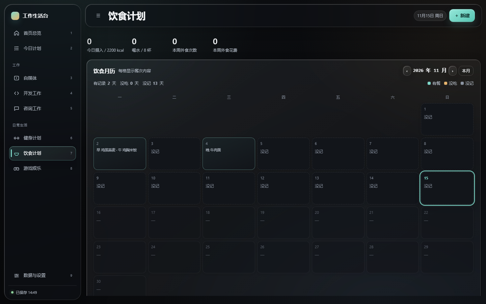

# 工作生活台 · Work Life Desk

一个**本地优先**的个人工作与生活控制台：浏览器界面 + 本机 Python 服务 + 本地 JSON 数据。

**不联网、不登录、没有云同步。** 所有数据只保存在运行它的那台电脑上。

> 这不是手机 App，也不是在线服务。它是一个 Windows 本地工具：解压、双击、打开浏览器就能用。

---

## 截图

### 首页总览



### 自媒体看板与发布数据



### 开发项目与里程碑



### 健身月历



### 饮食月历



> 截图中的内容均为演示数据，不包含任何真实个人记录。

---

## 这是什么

工作生活台把几件容易散落在不同工具里的事，放进一个本地面板：

| 模块 | 用来做什么 |
| --- | --- |
| 首页总览 | 一屏看清今天：任务、备忘、自媒体、开发、健身等摘要 |
| 今日计划 | 当天任务、优先级、顺延、完成情况与每日复盘 |
| 自媒体 | 灵感 → 待策划 → 制作中 → 待发布的内容流水线，发布数据与粉丝记录 |
| 开发工作 | 项目、需求、待办、Bug、开发日志、版本号与里程碑 |
| 咨询工作 | 线索管道、跟进提醒、沟通记录与收入台账 |
| 健身计划 | 周模板、逐组打卡、身体数据与训练月历 |
| 饮食计划 | 餐次记录、热量/饮水、外食统计与饮食月历 |
| 游戏娱乐 | 游戏库、想玩清单、每周时长额度 |
| 数据与设置 | 数据路径、条数统计、备份/恢复、主题与偏好 |

它不追求“大而全”，也不替代 Notion、Excel 或专业项目管理软件。它更像一个放在自己电脑上的、可以随手改的私人工作台。

---

## 快速开始（Windows）

### 方式 A：下载 Windows 一键包（推荐）

1. 打开本仓库的 **Releases** 页面，下载 `工作生活台-v1.0.0-Windows-x64.zip`。
2. 解压到一个**有写入权限**的文件夹，例如 `D:\工作生活台`。
   不建议放在 `C:\Program Files` 下面。
3. 双击 `启动.bat`。
   浏览器会自动打开；如果没有，手动访问 `http://127.0.0.1:8848/`。
4. 关闭后台服务：双击 `关闭.bat`。

一键包已经自带 Python 3.13.18 运行时，**不需要另外安装 Python**。

### 方式 B：从源码运行

源码仓库**不包含** `app/runtime/`（运行时体积较大，只放在 Release 包里）。

```bash
# 需要 Python 3.13
python app/server.py
```

然后访问 `http://127.0.0.1:8848/`。

macOS / Linux 没有做一键包，也没有做完整适配测试；如果你自己装了 Python 3.13，可以按上面的方式尝试。
**手机端不支持**：服务只监听本机 `127.0.0.1`，手机无法访问。

---

## 数据、备份与隐私

### 数据在哪里

```text
工作生活台/
├─ app/                 程序与服务
├─ data/
│  ├─ data.json         所有业务数据
│  └─ backups/          自动/手动备份
├─ 启动.bat
└─ 关闭.bat
```

- 数据文件是纯文本 JSON，可以用记事本打开查看。
- 每天首次修改会自动备份到 `data/backups/`，默认保留最近 30 天。
- 设置页可以手动备份、导出备份文件、从某天备份或文件恢复。
- 想换电脑：复制整个文件夹，再双击 `启动.bat`。

### 隐私

- 不请求外部网络，不上传数据，不登录账号。
- 没有云数据库、没有遥测、没有统计 SDK。
- 每个人下载后运行的都是独立副本，数据互不相通。

### 安全提示

程序只监听本机 `127.0.0.1`，不会对局域网或公网开放。
因为程序包含未签名的 `.bat` 和 Python 运行时，Windows SmartScreen 或杀毒软件可能提示“未知发布者”。如果你是从本仓库 Releases 下载的，可以选择放行；不要从陌生转载地址下载。

---

## 快捷键

| 快捷键 | 作用 |
| --- | --- |
| `1`–`9` | 切换九个页面 |
| `Ctrl+B` | 收起/展开侧栏 |
| `Ctrl+S` | 立即保存当前数据 |
| `N` | 新建当前模块条目 |
| `Esc` | 关闭抽屉/弹窗 |

---

## 技术结构

- **前端**：原生 HTML / CSS / ES Modules，无构建步骤，无前端第三方依赖。
- **服务端**：Python 标准库 `http.server`，只监听 `127.0.0.1`。
- **数据层**：本地 JSON + 每日备份 + 恢复校验。
- **界面**：macOS Liquid Glass 风格的石墨/白瓷双主题、玻璃卡片、响应式布局。

```text
app/
├─ server.py             本地 HTTP 服务与 API
├─ data_store.py         JSON 数据、备份、恢复、校验
├─ web/
│  ├─ index.html
│  ├─ styles/            设计变量与页面样式
│  └─ js/               页面、路由、存储、图表、日历
└─ runtime/              仅 Release 包包含
```

---

## 已知限制

- 只提供 **Windows 10/11 x64** 一键包。
- macOS / Linux 需要自行安装 Python 3.13，且未做完整适配测试。
- 手机端不支持。
- 没有云同步、多人协作、账号系统或自动抓取平台数据。
- 自媒体图表数据为**手动录入**，应用不会登录平台后台抓取。
- 项目仍在早期阶段，界面和数据结构可能继续调整。

---

## 开源协议

- 本项目代码采用 **MIT License**，见 [LICENSE](LICENSE)。
- Release 包内含 Python 3.13 运行时，Python 由 Python Software Foundation 发布，遵循 PSF License；详见 [THIRD_PARTY_NOTICES.md](THIRD_PARTY_NOTICES.md)。

---

## 给网站/展示用的资料

如果要在个人网站上放这个项目的入口或详情页，可直接使用：

- [网站交接文案与截图清单](docs/website-handoff.md)
- [GitHub 发布步骤](docs/github-publish-guide.md)

---

## 作者

**浪漫浩宇 · LMHYCRAFT**

如果这个项目对你有用，欢迎 Star、提 Issue，或者把它改成适合你自己的版本。
